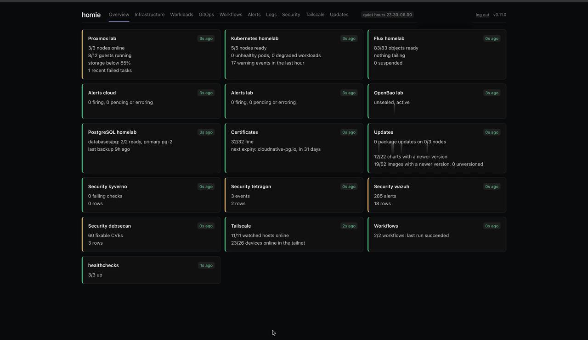
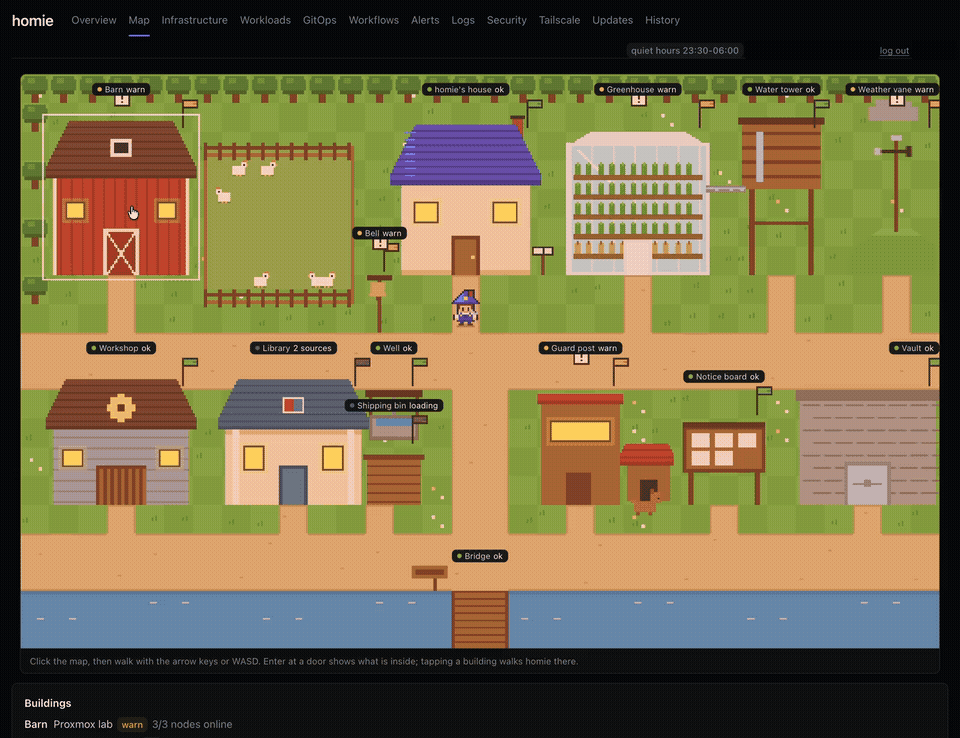

# homie

[](https://github.com/franzramadhan/homie/actions/workflows/coverage.yml)
[](https://github.com/franzramadhan/homie/actions/workflows/coverage.yml)
[](https://github.com/franzramadhan/homie/actions/workflows/coverage.yml)
[](https://github.com/franzramadhan/homie/releases/latest)

One page for the whole homelab: hypervisor hosts and guests, Kubernetes
workloads, GitOps state, alerts and security findings, with a few safe
actions and deep links to the specialist UIs for everything else.

**Live demo: [homie-demo.franzramadhan.dev](https://homie-demo.franzramadhan.dev)**
(click "Try the demo"). It is the author's lab, read-only: a demo role limited
to the Infrastructure, Workloads and GitOps pages, three namespaces and the
guests tagged `demo`. The lab sleeps from 23:30 to 06:00 WIB (UTC+7).



<sub>A full instance (names, addresses and versions blurred). The demo shows fewer pages.</sub>



<sub>The Map page (RFC 0028): every enabled part of the lab is a building.</sub>

Homie is a single Rust binary with the web UI embedded. It has no database.
It runs:

- **in a cluster**, behind any OIDC provider (Authentik, Keycloak, Authelia,
  Pocket ID, Zitadel, Cloudflare Access, Google, ...)
- **on a laptop or LAN box**, bound to loopback, so the lab's state (or its
  last known state) is still visible when the cluster or the hosts are down

## Integrations

Every integration is optional. Configure only what your lab has.

| Layer | Integration | Notes |
|---|---|---|
| Hypervisor | Proxmox VE | One or more clusters, any node as endpoint, start, shutdown and reboot for guests |
| Kubernetes | Any conformant cluster | k0s, k3s, RKE2, Talos, kind, minikube, managed clouds. Auth by kubeconfig, in-cluster ServiceAccount, or the user's forwarded OIDC token. |
| GitOps | Flux v2, Argo CD | Flux sources, Kustomizations, HelmReleases with reconcile; Argo CD Applications with refresh |
| Helm | Helm 3 release secrets | Chart, version and status. Values are never shown. |
| Alerts and queries | Grafana (self-hosted or Grafana Cloud), any number of instances | Through the Grafana HTTP API with a Viewer token |
| Logs | VictoriaLogs (LogsQL), Loki (LogQL) through Grafana | Search page, prefilled from pods and nodes |
| Security | Presets: Kyverno, Tetragon, Wazuh, debsecan | Tetragon and Wazuh read VictoriaLogs through Grafana |
| CI and IaC runs | GitHub Actions | Watched workflows (Terraform plan and apply, ...) through a read-only GitHub App |
| Updates | Proxmox apt, Kubernetes and its distribution, Flux, Helm charts | Package updates and reboot pending per node, version skew, and (opt-in) the newest Kubernetes, k0s, k3s, RKE2, Talos, Flux and chart releases through GitHub, OCI registries and Helm indexes, with release notes and a security hint |
| Certificates | Any TLS endpoint, by handshake | Leaf, intermediates and roots: the integrations' own endpoints, listed hosts, and hostnames from Ingress, Gateway API and annotations; cert-manager renewal failures as an extra |
| Outage signals | Tailscale API, healthchecks.io (hosted or self-hosted) | Useful from outside when the lab is down |
| Deep links | Any Kubernetes UI by URL template (Headlamp built in), Grafana, Proxmox UI | |

Behavior that suits a homelab:

- **Quiet hours.** Parts of the lab that are powered off on a schedule show
  as "scheduled off", not as an outage.
- **Live updates.** Results are pushed over server-sent events; Kubernetes
  and Flux changes show up within seconds, polling is the fallback.
- **Roles.** A read-only view limited to some pages, explicit namespaces and
  tagged Proxmox guests, enforced by Kubernetes RBAC as well. It powers the
  public demo and its passwordless "Try the demo" button.
- **Notifications.** When a card changes status and the change holds, a
  message goes to ntfy, a Slack-compatible webhook (Slack, Mattermost,
  Discord) or any JSON webhook. Quiet hours stay quiet, and the lab
  waking up in the morning is not news.
- **Metrics and JSON logs.** An opt-in Prometheus `/metrics` on its own
  port: card status, query latency and failures, certificate expiry, how
  many updates are pending. No versions, IPs or emails in labels. Logs can
  be one JSON object per line.
- **Watched workflows without a restart.** Pick GitHub workflows in the UI;
  the list is saved in a ConfigMap (in a cluster) or a file.
- **TLS options per integration.** Verify against a custom CA, verify
  against another name than the address, skip verification, or use plain
  HTTP. The last two are opt-in and flagged in the UI and the logs.
- **Configuration.** A TOML file, `HOMIE__*` environment variables, or both.
  Secrets come from env, files or a command (Keychain, `pass`, `op read`).

## Install

### Laptop or Linux box

```bash
mise use -g github:franzramadhan/homie          # or: brew install franzramadhan/tap/homie
mkdir -p ~/.config/homie
curl -fsSL https://raw.githubusercontent.com/franzramadhan/homie/main/examples/local.toml \
  -o ~/.config/homie/config.toml                   # then edit it
homie check                                        # validates and tests every integration
homie serve                                        # http://127.0.0.1:7777
```

To keep it running: `contrib/io.github.franzramadhan.homie.plist` (launchd)
or `contrib/homie.service` (systemd user unit).

### Container

```bash
docker run --rm -p 127.0.0.1:7777:7777 \
  -e HOMIE__LISTEN=0.0.0.0:7777 -e HOMIE__ALLOW_UNAUTHENTICATED=true \
  -v ./config.toml:/etc/homie/config.toml:ro -e HOMIE_CONFIG=/etc/homie/config.toml \
  ghcr.io/franzramadhan/homie:<version> serve
```

`allow_unauthenticated` is only safe because the port is published on the
host's loopback. See `examples/docker-compose.yaml`.

### Kubernetes

With Helm (config goes in the `config` value, secrets in `existingSecret`):

```bash
helm install homie oci://ghcr.io/franzramadhan/charts/homie --version <version> \
  -n homie --create-namespace -f my-values.yaml
```

Or the dependency-free kustomize base:

```bash
kubectl apply -k deploy/kubernetes
kubectl -n homie create secret generic homie \
  --from-literal=HOMIE__PUBLIC_URL=https://homie.example.com \
  --from-literal=HOMIE__AUTH__ISSUER=https://auth.example.com/application/o/homie/ \
  --from-literal=HOMIE__AUTH__CLIENT_ID=homie \
  --from-literal=HOMIE__AUTH__CLIENT_SECRET=... \
  --from-literal=HOMIE__AUTH__ALLOWED_EMAILS='[me@example.com]'
```

Then expose the `homie` Service with your Ingress, Gateway API route or
Tailscale Ingress. Register `https://<host>/auth/callback` as the redirect
URI at your provider. The Helm view needs `deploy/kubernetes/rbac-helm.yaml` (chart:
`rbac.helmReleases=true`).

## Configure

Start from an example in `examples/`: `local.toml` (laptop),
`server-oidc.toml` (any OIDC provider), `reference-lab.toml` (the author's
lab, Cloudflare Access + Tailscale + k0s) or `docker-compose.yaml`. Every key,
with its default, is in [CONFIG.md](CONFIG.md).

- Any key can be set by environment: `HOMIE__PROXMOX__LAB__TOKEN=...`
  overrides `[proxmox.lab] token`. Lists use `[a, b]`.
- Secrets can be a plain string, `{ env = "NAME" }`, `{ file = "/path" }` or
  `{ cmd = "security find-generic-password -s homie-pve -w" }`.
- Proxmox tokens: a dedicated user with `PVEAuditor` is read-only; add
  `VM.PowerMgmt` for the power buttons. Tag guests listed in
  `protected_tags` to require typing their name before an action.
- Login: `[local_login]` (username `homie`, a password you set with
  `homie hash-password`, or a random one generated into `state_dir` at the
  first start), `[auth]` for any OIDC provider, or both on one login page.
  Without either, Homie only listens on loopback unless you set
  `allow_unauthenticated = true`.
- Metrics: `[metrics] listen = "127.0.0.1:9477"`, optionally `token`; logs:
  `log_format = "json"`. Metric names, log events and alert rules are in
  [RFC 0024](rfc/0024-metrics.md) and `examples/metrics-alerts.yaml`.
- Roles and a public demo: `[roles.<name>]` and `[demo]`, see
  [RFC 0016](rfc/0016-roles-demo.md). Run a public demo as its own instance
  with read-only credentials only.

## Develop

```bash
cd web && bun install && bun run build && cd ..   # the binary embeds web/dist
cargo run -- serve --config examples/local.toml
cd web && bun run dev                              # UI with hot reload, API proxied to :7777
cargo test && cargo clippy --all-targets -- -D warnings
```

## Tested with

Kubernetes (k0s 1.36), Flux 2.9, Proxmox VE 9.2, Grafana 13 and Grafana
Cloud, Cloudflare Access as the OIDC provider. Other versions and
distributions are expected to work. Reports are welcome.

## Status

Alpha: 0.x releases may change config keys or behavior between versions.
The design is in [RFC 0001](rfc/0001-homie-foundation.md); every feature since
has its own RFC in [`rfc/`](rfc/), listed in the [roadmap](ROADMAP.md).

## License

MIT, see [LICENSE](LICENSE).
