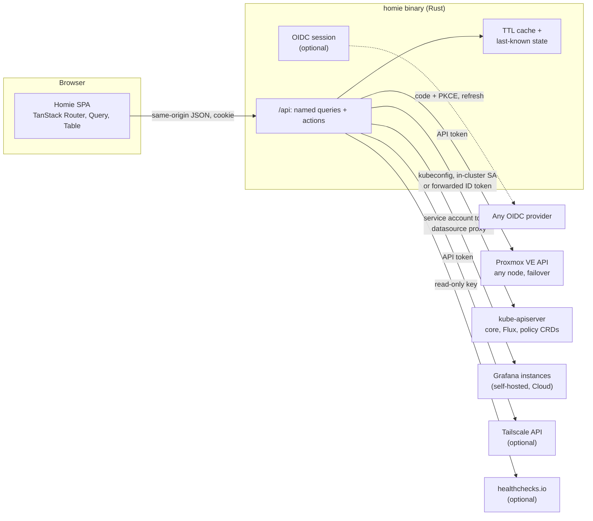
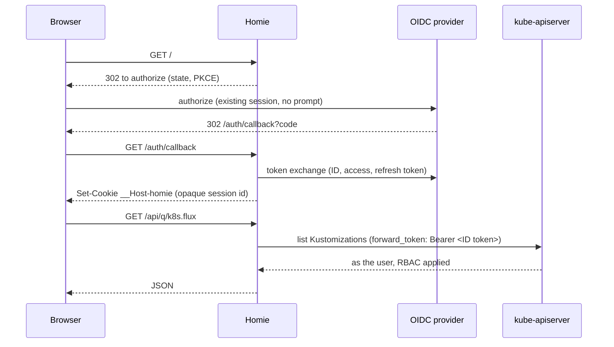

# 0001: Homie foundation and v0.1.0

| Status | Date | PR | Release |
|---|---|---|---|
| implemented | 2026-10-22 | #2 | v0.1.0 |

> Homie is one small binary that shows a whole homelab on one page: Proxmox
> hosts and guests, Kubernetes, Flux, alerts and security findings. It allows
> a few safe actions and links out to the specialist UIs for depth. It runs in
> a cluster behind any OIDC provider, or on a laptop so it still shows what
> happened when the lab itself is down. Every integration is optional and is
> configured by file or environment variables.

## Problem

A typical self-hosted lab is run through one UI per layer. The author's lab
is the reference case (see [Reference deployment](#reference-deployment)):

| Layer | Tool | Gap |
|---|---|---|
| Hypervisor (Proxmox VE cluster) | Proxmox UI, one per node origin | No view next to the workloads that run on it |
| Kubernetes | Headlamp (or Lens, k9s, Dashboard) | Knows nothing about the VMs under it |
| GitOps (Flux) | Headlamp plugin, `flux` CLI | Separate again |
| Metrics, logs, alerts | One or more Grafanas (self-hosted, Grafana Cloud) | Separate logins, separate alert lists |
| Security | Policy reports, runtime events, endpoint alerts, CVE scans | Spread over log queries and dashboards. Some tools have no UI at all. |

Answering "is the lab healthy?" means opening four tabs. Answering "what
happened?" during an outage gets worse, because the UIs that run inside the
cluster are down with it. Many homelabs also power off on a schedule, so
"down" is a normal daily state and has to read as such.

## Goals

1. **One overview:** the health of every layer on one page, with alerts from
   every Grafana.
2. **Server layer:** Proxmox cluster, nodes, guests (VM and LXC), storage and
   HA, with power actions.
3. **Workload layer:** Kubernetes nodes, workloads, Helm releases and Flux
   objects, with Flux reconcile.
4. **Security page:** policy, runtime, endpoint and host CVE findings in one
   place.
5. **One login:** any OIDC provider. If that provider already holds a session,
   Homie signs in without a prompt.
6. **Works from outside during an outage:** a laptop instance shows off-site
   signals and the last known state.
7. **Easy to adopt:** one binary or one image, and every integration optional.
   Config comes from a TOML file, environment variables, or both. Nothing
   assumes Cloudflare, Tailscale or a specific Grafana setup.
8. **Light:** SPA embedded in the binary, no database, small image.

## Non-goals (v0.1.0)

- Replacing Headlamp, Grafana or the Proxmox UI. Homie links to them for logs,
  YAML, exec, consoles, dashboards and editing.
- Multi-user roles. Authorization is an allowlist of emails or groups, plus
  whatever the backends enforce.
- Storing metrics or logs. Homie reads from existing stores and keeps only a
  last-known snapshot.
- Changing desired state. Git stays the source of truth: Homie never edits
  manifests, values or VM config.
- Flux suspend and resume, consoles (noVNC, exec) and native log search.
  These are later milestones.

## Proposal

### Compatibility

Homie uses only stable, public APIs, so it is not tied to the reference lab:

| Integration | Expected to work with | Tested with |
|---|---|---|
| Kubernetes | Any conformant distribution (k0s, k3s, RKE2, Talos, kind, minikube, EKS, GKE, AKS) | k0s 1.36 |
| Flux | Flux v2 GA APIs (`source/v1`, `kustomize/v1`, `helm/v2`) | Flux 2.9 |
| Proxmox VE | 8.x and 9.x | 9.2 |
| Grafana | Self-hosted 10+ and Grafana Cloud | 13, Grafana Cloud |
| OIDC | Any provider with discovery | Cloudflare Access |

Flux is the only GitOps tool and Grafana the only alert source in v0.1.0.
Argo CD and a direct Prometheus Alertmanager source are listed under Later.

### Architecture



- **Backend for frontend.** The Proxmox API and kube-apiserver send no CORS
  headers, and credentials must not reach the browser, so a backend is
  required. The browser only talks to Homie on its own origin.
- **Named queries, not a generic proxy.** The API exposes a fixed set of
  queries (`pve.resources`, `k8s.flux`, `security.wazuh`, ...) and actions
  (`pve.guest.shutdown`, `flux.reconcile`, ...). Each query returns
  `{ data, fetched_at, stale, quiet, error }`. This gives an allowlist by
  construction, makes each result cacheable, and keeps backend URLs and query
  languages out of the browser.
- **TTL cache.** Each result is cached for 10 to 30 s, so several tabs do not
  multiply backend load. When a fetch fails, Homie returns the last good
  result with `stale: true` and the error.
- **Last-known state.** It is always kept in memory. When `state_dir` is set,
  it is also written to `state_dir/snapshot.json` (atomic rename, at most
  once per 30 s) and loaded at start. Laptops set `state_dir`. In-cluster
  instances usually do not: when the cluster is down, Homie is down with it,
  so a file adds a PVC for no benefit.
- **Polling.** TanStack Query refetches every `refresh_seconds` (default 15)
  while the tab is visible. There are no watches or SSE in v0.1.0; since
  v0.4.0 live updates (RFC 0009) push results and polling is the fallback.
- **Every integration is optional.** A section left out of the config turns
  that integration off and hides its UI. Homie with only `[proxmox.*]` is a
  valid setup, and so is Homie with only `[kubernetes.*]`.

### Profiles

There is no `mode` switch. Behavior follows from what is configured:

| | Laptop (local) | LAN box (Docker) | Cluster (server) |
|---|---|---|---|
| `[auth]` | none | none, or OIDC | OIDC |
| Listen | `127.0.0.1:7777` | `0.0.0.0:7777` in the container, published on `127.0.0.1` or behind an auth proxy | `0.0.0.0:8080` behind an Ingress or Gateway |
| Kubernetes auth | `kubeconfig` | `kubeconfig` | `in_cluster` or `forward_token` |
| `state_dir` | set | set | unset |
| Secrets | `{ cmd = ... }` (Keychain, `pass`) or env | env, files | env from a Secret |
| Install | `mise use -g github:franzramadhan/homie`, launchd or systemd user unit | `docker run` / Compose | `deploy/kubernetes` kustomize base |

The laptop profile is the outage tool. When the lab is down it cannot query
Proxmox or the cluster either. It shows instead:

- **Tailscale API** (if configured): online and last seen per host and VM.
  This tells a dead host from a dead cluster.
- **Grafana Cloud or any off-site Grafana:** firing host alerts.
- **healthchecks.io** (hosted or self-hosted): watchdog and backup checks.
- **Last-known state** from `snapshot.json`, with its age.

### Authentication

Two login methods, each optional, both offered on one login page (`/login`):

- **`[local_login]`: username and password.** The username defaults to
  `homie`. There is no default password, because a password published in
  this repo would open every instance that never changed it. Either set
  `password_hash` (an argon2id string from `homie hash-password`), or leave
  it out and Homie generates a random password at the first start. The
  password goes to `state_dir/initial-password` and its hash to
  `state_dir/local-login.hash`, both mode 0600; the log only names the file.
  After 10 wrong attempts within 15 minutes, logins are refused for 5
  minutes. Password sessions carry no ID token, so `forward_token` clusters
  need an OIDC login.
- **`[auth]`: OIDC** with any standards-compliant provider (discovery via
  `issuer/.well-known/openid-configuration`): Cloudflare Access, Authentik,
  Keycloak, Authelia, Pocket ID, Zitadel, Google, and others. The login page
  shows "Sign in with SSO"; with OIDC alone it goes straight to the provider.

With neither, there is no login, and Homie refuses to listen on a
non-loopback address unless `allow_unauthenticated = true` is set. That
setting is for two cases: a container published only on the host's
loopback, and an instance behind an auth proxy (oauth2-proxy, Authelia,
Cloudflare Access application, Tailscale Serve). Homie logs a warning at
start when it is on.

The session cookie is `__Host-homie` (Secure) when `public_url` is HTTPS or
localhost. Password login on a plain-HTTP LAN address works with a plain
`homie` cookie, but the password then crosses the network unencrypted.



- Authorization code flow with PKCE (`openidconnect` crate). The default
  scopes are `openid email profile offline_access`. Without `offline_access`
  (and refresh tokens enabled at the provider), some providers issue no
  refresh token and the session ends when the ID token expires.
- Sessions are server-side and in memory. The cookie holds only an opaque id
  (`__Host-homie`, `HttpOnly`, `Secure`, `SameSite=Lax`). Tokens never reach
  the browser.
  `ponytail: in-memory sessions, one replica; a restart means one silent re-login. Move to an encrypted cookie if a second replica is ever needed.`
- Homie refreshes tokens server-side before the ID token expires (60 s
  margin).
- Access is allowed when the `email_claim` value is in `allowed_emails` or a
  `groups_claim` value is in `allowed_groups`. With both lists empty, Homie
  refuses to start.
- CSRF: every action is a `POST`, and it needs `SameSite=Lax`, an `Origin`
  header that matches `public_url`, and a custom `X-Homie: 1` header.
- Logout clears the Homie session only. The provider session is the
  provider's.

### TLS for every HTTP integration

Proxmox, Grafana, Tailscale and healthchecks share the same options, because
labs differ: self-signed certificates, private CAs, certificates issued for a
name other than the address used, or plain HTTP on a trusted LAN.

| Key | Default | |
|---|---|---|
| URL scheme | | `http://` uses no TLS. `https://` uses TLS. |
| `tls_verify` | `true` | `false` skips certificate checks. Homie logs a warning at start and the UI marks the integration "TLS unverified". |
| `ca_file` | system roots | PEM bundle to trust instead, for example the Proxmox cluster CA (`/etc/pve/pve-root-ca.pem`) or a lab CA |
| `tls_server_name` | host from the URL | Name to verify the certificate against. Use it to connect by LAN IP to a server whose certificate names something else. |

Proxmox endpoints take these per endpoint, because each node has its own
certificate. A bare string is shorthand for `{ url = "..." }`.

`tls_verify = false` and `http://` send API tokens unprotected on the network.
They are supported because some labs need them, never as defaults.

### Quiet hours

Many homelabs power off on a schedule. Without special handling, the
overview turns red every night, and red every night teaches you to ignore
red.

```toml
[quiet_hours]
window = "23:30-06:00"          # may cross midnight
timezone = "Asia/Jakarta"       # IANA name; default is the host's zone
```

During the window, an integration or host marked `quiet = true` (or matched
by `quiet_hosts`) that is unreachable or offline shows as grey "scheduled
off", not red, and its alerts are listed but not counted. Anything not marked
quiet still goes red, which is the point: the off-site Grafana, the
always-on host and the healthchecks should never be dark.

### Integrations

#### Proxmox VE

- **Auth:** an API token (`user@realm!tokenid=secret`). Recommended: a
  dedicated user and token per Homie instance, privilege separated, with a
  role made of the `PVEAuditor` privileges plus `VM.PowerMgmt` on `/`. With
  `PVEAuditor` alone, Homie is read-only and hides the power buttons.
- **Endpoints:** a list, tried in order. Any node answers for the whole
  cluster, so one dead node does not blank the page. Several clusters are
  several `[proxmox.<name>]` sections.
- **Reads:** `/cluster/status` (quorum, nodes online), `/cluster/resources`
  (one call returns every node, guest and storage with CPU, memory, disk,
  status and tags), `/cluster/ha/status/current`, and
  `/nodes/{node}/tasks?errors=1&limit=20` (recent failed tasks).
- **Actions:** start, shutdown (ACPI or the guest agent), reboot and stop
  (hard power-off), for VMs and containers. Each action:
  - needs a confirm dialog;
  - is refused while the guest already has a running task (a second click
    would only fail on the Proxmox lock);
  - for stop, needs the guest name typed, on every guest;
  - needs the guest name typed when the guest has a tag listed in
    `protected_tags` (for example Kubernetes controllers: one down is fine,
    two loses etcd quorum);
  - returns the task UPID, and the UI polls that task until it is done;
  - logs `msg=action action=pve.guest.shutdown user=<email> target=<vmid> task=<upid> result=ok`.
    Proxmox's own task log shows the token, Homie's log shows the person.

#### Kubernetes

| `auth` | Identity | Use |
|---|---|---|
| `kubeconfig` (default outside a cluster) | whatever the kubeconfig context is | laptop, LAN box |
| `in_cluster` (default inside a cluster) | Homie's ServiceAccount, with the ClusterRoles from `deploy/kubernetes` | most cluster installs |
| `forward_token` | the logged-in user: Homie sends the user's OIDC ID token | clusters whose apiserver already trusts the same OIDC issuer; no standing privilege in Homie |

`forward_token` needs `[auth]`, and the apiserver must accept that client's
ID tokens (`--oidc-*` flags or structured `AuthenticationConfiguration`).
Some API proxies replace the caller's identity: the Tailscale operator proxy
in auth mode does, for example. Tokens forwarded through such a proxy are
ignored, so `forward_token` needs a direct path to the apiserver.

- **Reads:** nodes (Ready, kubelet version, allocatable vs requests),
  namespaces, Deployments / StatefulSets / DaemonSets (ready vs desired),
  pods that are not Ready or are restarting, recent Warning events, and Helm
  releases.
- **Helm releases:** read from `Secret`s of type `helm.sh/release.v1`
  (base64, gzip, JSON). Homie returns name, namespace, chart, chart and app
  version, revision, status and last deployed time. It never returns `config`
  (values) or `manifest`, because values can hold secrets. With `in_cluster`,
  this needs `list secrets`, which RBAC cannot narrow to Helm's secrets. It
  is therefore a separate, optional ClusterRole (`homie-helm`). Without it,
  the Helm view is hidden.
- **Links:** with `headlamp_url` set, objects deep-link to Headlamp for YAML,
  logs and exec.

#### Flux

- **Reads:** `GitRepository`, `OCIRepository`, `HelmRepository`, `HelmChart`
  (source.toolkit.fluxcd.io/v1), `Kustomization`
  (kustomize.toolkit.fluxcd.io/v1) and `HelmRelease`
  (helm.toolkit.fluxcd.io/v2). For each: Ready condition, reason, message,
  last applied revision, suspend flag, and time since the last transition.
- **Action: reconcile only.** Homie merge-patches the annotation
  `reconcile.fluxcd.io/requestedAt: <RFC3339 now>`. "With source" patches
  the referenced source first, the same as `flux reconcile --with-source`.
  An annotation-only change passes policies that protect Flux-managed
  objects, and Flux never reverts it.
- **Why no suspend in v0.1.0:** when the parent Kustomization's manifests set
  `spec.suspend` explicitly (the reference lab sets `suspend: false` on every
  app), the parent's next reconcile reverts a suspend made through the API.
  Admission policies that protect Flux-managed objects may also reject the
  patch. Suspend can come back as an opt-in for clusters where git does not
  own the field (see Later).

#### Grafana

Any number of `[grafana.<name>]` instances (self-hosted or Grafana Cloud),
each with a service account token with the Viewer role. Homie uses the
Grafana HTTP API only, so a laptop needs to reach Grafana, not the data
stores behind it (those are often not routed outside the cluster).

- **Alerts:** `GET /api/prometheus/grafana/api/v1/alerts` (Grafana-managed
  rules) per instance. Firing and pending alerts are merged into one list,
  each tagged with its instance.
- **Queries:** `GET /api/datasources/proxy/uid/<uid>/...` runs PromQL
  (Prometheus, Mimir, VictoriaMetrics) or LogsQL (VictoriaLogs) for the
  security presets below. LogQL (Loki) variants come with overridable
  queries (see Later).
- **Links:** dashboard and Explore deep links, with query and time range
  prefilled.
- **No iframes.** Many SSO front doors refuse framing, a Grafana on another
  site loses its cookies inside a frame, and Grafana Cloud cannot share a
  session. Native tiles plus deep links avoid all three.

#### Security presets

Each preset is optional and points at an integration that already exists.
The datasource uid is configurable. The query is built in for v0.1.0 and
becomes overridable later. The first four presets cover what the reference
lab runs. A preset is only a named query plus a table layout, so adding one
for another tool (Falco, Trivy Operator, CrowdSec) is a small change.

| Preset | Source | Default query |
|---|---|---|
| `kyverno` | a `[kubernetes.*]` entry | `PolicyReport` / `ClusterPolicyReport`: fail and warn counts per policy and namespace. The CRD group (`wgpolicyk8s.io/v1alpha2` or `openreports.io/v1alpha1`) is discovered at start. |
| `tetragon` | Grafana + VictoriaLogs datasource | Policy hits and `KPROBE_ACTION_SIGKILL` events, last 24 h, by policy, namespace and binary |
| `wazuh` | Grafana + VictoriaLogs datasource | Alerts with `rule.level >= min_level` (default 7), last 24 h, by agent and rule |
| `debsecan` | Grafana + Prometheus-compatible datasource | `debsecan_vulnerabilities` (fixable and high urgency) per host, and days since `debsecan_last_run_timestamp_seconds` |

Each row links to the matching Grafana Explore query.

#### Tailscale and healthchecks.io (optional)

- **Tailscale:** `GET /api/v2/tailnet/-/devices`, with an API access token or
  an OAuth client with only `devices:core:read`. The Tailscale page lists
  every device: online state, last seen, OS, address, tags, user, client
  version (and whether an update exists) and key expiry. Devices matching the
  `hosts` globs are "watched": only they count on the overview card.
- **healthchecks.io:** `GET /api/v3/checks/` with a read-only API key, on
  `healthchecks.io` or any self-hosted instance (`url`). Homie shows status,
  last ping and next expected ping per check.

### UI

| Route | Shows |
|---|---|
| `/` Overview | One card per configured layer: Proxmox (quorum, nodes up, guests running), Kubernetes (nodes Ready, unhealthy pods), Flux (not Ready count), alerts (firing per Grafana), security (counts), outage signals. Each card shows data age and the quiet state. |
| `/infra` | Proxmox nodes, guests (filter by node, type, tag, status; power actions), storage, HA, failed tasks |
| `/workloads` | Kubernetes nodes, workloads, unhealthy pods, warning events, Helm releases |
| `/gitops` | Flux sources, Kustomizations, HelmReleases; reconcile |
| `/observability` | Merged alert list, links to each Grafana |
| `/security` | The configured security presets |
| `/tailscale` | Every tailnet device: status, OS, address, tags, user, client version, key expiry; watched hosts marked |

- Stack: Vite, React, TanStack Router (file routes), TanStack Query (polling,
  cache), TanStack Table (sort, filter), Tailwind CSS. Bun for packages.
- No chart library in v0.1.0. Usage bars are CSS, and charts live in Grafana.
- Budget: initial JS under 250 kB gzip. The UI ships in the binary
  (`rust-embed`).

### Backend stack

Rust, static musl binary, `scratch` image: `axum`, `tokio`, `kube` +
`k8s-openapi`, `openidconnect`, `reqwest` with rustls, `serde`, `figment`
(TOML plus environment layering), `rust-embed`, `tower-http`. No database.

### Configuration

Sources, lowest to highest precedence: built-in defaults, the TOML file,
environment variables. The file is optional: a container can be configured
by environment alone.

- **File:** `--config <path>`, or `HOMIE_CONFIG`. If neither is set, Homie
  reads `~/.config/homie/config.toml`, then `/etc/homie/config.toml`, if they
  exist.
- **Environment:** `HOMIE__` plus the key path, joined with `__` and
  uppercased.
  - `HOMIE__LISTEN=0.0.0.0:8080`
  - `HOMIE__AUTH__ISSUER=https://auth.example.com/application/o/homie/`
  - `HOMIE__PROXMOX__LAB__TOKEN=homie@pve!lab=...`
  - `HOMIE__AUTH__ALLOWED_EMAILS=[me@example.com]` (lists use `[a, b]`)
- **Secrets:** every secret field takes a plain string, or one of these
  references:

  | Form | Example | Use |
  |---|---|---|
  | `{ env = "NAME" }` | `{ env = "PVE_TOKEN" }` | an existing variable with another name |
  | `{ file = "path" }` | `{ file = "/run/secrets/pve-token" }` | mounted Secret files, Docker secrets |
  | `{ cmd = "..." }` | `{ cmd = "security find-generic-password -s homie-pve -w" }` | macOS Keychain, `pass`, `secret-tool`, `op read` |

  Prefer a reference over a plain string in a file that may get committed.
  `cmd` runs at start, and again after a 401 from that backend.

`homie check` loads the config the same way `homie serve` does. It prints
the effective config with secrets redacted, then tests each integration
(reachability, TLS, auth, permissions) and prints one line per integration.

Full key reference, with defaults:

```toml
listen = "127.0.0.1:7777"
public_url = "http://127.0.0.1:7777"   # required with [auth]; OIDC redirect is public_url/auth/callback
state_dir = ""                         # set to keep snapshot.json, e.g. "~/.local/state/homie"
refresh_seconds = 15
live_updates = true                    # push query results over SSE (RFC 0009)
allow_unauthenticated = false          # only for loopback-published containers or an auth proxy

[quiet_hours]                          # optional
window = "23:30-06:00"
timezone = "UTC"

[local_login]                          # optional: username + password login
username = "homie"
password_hash = { env = "HOMIE_PASSWORD_HASH" }  # from `homie hash-password`; absent = generated into state_dir

[auth]                                 # optional: OIDC login
issuer = "https://idp.example.com/"
client_id = "homie"
client_secret = { env = "OIDC_CLIENT_SECRET" }
scopes = ["openid", "email", "profile", "offline_access"]
email_claim = "email"
groups_claim = ""                      # e.g. "groups"
allowed_emails = []
allowed_groups = []
roles = {}                             # RFC 0016: { "<email>" = "<role>" }

[proxmox.<name>]                       # optional, repeatable
endpoints = ["https://pve1.example.com:8006"]  # or { url, tls_verify, ca_file, tls_server_name }
token = { env = "PVE_TOKEN" }
tls_verify = true                      # default for all endpoints
ca_file = ""
protected_tags = []
ui_url = ""                            # deep links; default first endpoint
quiet = false

[kubernetes.<name>]                    # optional, repeatable
auth = "kubeconfig"                    # kubeconfig | in_cluster | forward_token
kubeconfig = "~/.kube/config"
context = ""                           # default: current context
headlamp_url = ""                      # fills the link templates for Headlamp
headlamp_cluster = "main"              # {cluster} in link templates
# [kubernetes.<name>.links]            # RFC 0007: node, pod, workload, flux URL templates
# [kubernetes.<name>.metrics]          # RFC 0012: grafana, datasource, cpu, memory, node_label
# cnpg_max_backup_age_hours = 26       # RFC 0011: older last backup is amber
# argocd_url = ""                      # RFC 0005: deep links to Argo CD Applications

# [openbao.<name>]                     # RFC 0011: url + TLS options, quiet; unauthenticated health
quiet = false
# forward_token takes the apiserver address and CA from `kubeconfig` when set,
# else from the pod (in-cluster).

[grafana.<name>]                       # optional, repeatable
url = "https://grafana.example.com"
ui_url = ""                            # links (alert rules, Explore); default url
token = { env = "GRAFANA_TOKEN" }
tls_verify = true
ca_file = ""
tls_server_name = ""
quiet = false
ignore_alerts = ["Watchdog"]           # never listed, e.g. an always-firing heartbeat

[security.kyverno]
kubernetes = "<name>"
[security.tetragon]
grafana = "<name>"
datasource = "<uid>"                   # VictoriaLogs
filter = "k8s.container.name:export-stdout"   # LogsQL selecting Tetragon's export
[security.wazuh]
grafana = "<name>"
datasource = "<uid>"                   # VictoriaLogs
filter = "k8s.namespace.name:wazuh k8s.container.name:alerts"
min_level = 7
[security.debsecan]
grafana = "<name>"
datasource = "<uid>"

[logs]                                 # optional, RFC 0008
max_rows = 1000
# [[logs.datasources]]                 # label, grafana, datasource, type (victorialogs | loki), pod_query, node_query

[tailscale]                            # optional
tailnet = "-"
api_key = { env = "TS_API_KEY" }       # or oauth_client_id + oauth_client_secret
hosts = ["*"]                          # watched: counted on the overview
quiet_hosts = []

[github]                               # optional, RFC 0014
# app_id = 123456                      # GitHub App (Actions: read), installation tokens
# private_key = { file = "~/.config/homie/github-app.pem" }
# token = { env = "GITHUB_TOKEN" }     # or a fine-grained token
# client_id, client_secret             # optional: the sign-in picker
# [[github.watch]]                     # repo = "owner/name", workflow = "apply.yaml"
# store = "auto"                       # picker saves: auto, configmap, file, off (RFC 0015)

[roles.demo]                           # optional, RFC 0016: a read-only view
# pages = ["infra", "workloads", "gitops"]
# namespaces = ["apps"]                # explicit names, no globs
# proxmox_tags = ["demo"]              # guests shown only with one of these tags
# kubernetes_service_account = "homie/homie-demo"   # impersonated for Kubernetes reads

[demo]                                 # optional: "Try the demo" on the login page
# (and [local_login] role = "demo" gives the password user that role too)
# role = "demo"
# max_sessions = 200                   # one hour each

[healthchecks]                         # optional
url = "https://healthchecks.io"
api_key = { env = "HC_API_KEY" }
quiet = false
```

### Logs

| | |
|---|---|
| `msg=query source=<name> ms=<n> status=ok\|error\|stale\|quiet` | Per backend fetch (debug level unless error) |
| `msg=action action=<name> user=<email> target=<id> result=ok\|error` | Every write, always logged |
| `msg=login user=<email> result=ok\|denied` | Logins and allowlist denials |
| `msg=insecure integration=<name> reason=tls_verify_off\|plain_http\|unauthenticated` | At start, once per weakened setting |
| `GET /healthz` | Liveness, no backend calls |

Logs are `key=value` lines on stdout (color only on a terminal; `RUST_LOG`
sets the level). There is no `/metrics` in v0.1.0. `homie check` prints the
effective config as JSON with secrets shown only by their source
(`env:NAME`, `file:/path`, `cmd:...`, `<redacted>`).

### Distribution

- **Binaries:** GitHub Releases on tag `v*`: `aarch64-apple-darwin`,
  `x86_64-apple-darwin`, `x86_64-unknown-linux-musl`,
  `aarch64-unknown-linux-musl`. They are named so the `mise` `github:`
  backend finds them (`mise use -g github:franzramadhan/homie`). Plain
  `curl` and `tar` work too.
- **Image:** `ghcr.io/franzramadhan/homie:<version>` from `scratch`, user
  10001, multi-arch (amd64, arm64), built natively per arch.
- **Kubernetes:** `deploy/kubernetes/` kustomize base: Namespace,
  ServiceAccount, ClusterRoles `homie-reader` (reads), `homie-flux` (patch
  Flux objects, for reconcile) and optional `homie-helm` (list secrets),
  Deployment (1 replica, non-root, read-only root filesystem), Service, and a
  ConfigMap for `config.toml`. Exposure (Ingress, Gateway API, Tailscale
  Ingress) is the user's overlay, with examples.
- **Laptop service:** `contrib/` holds a launchd plist and a `systemd --user`
  unit.
- **Examples:** `examples/` holds a working config per profile:
  `local.toml`, `docker-compose.yaml`, `server-oidc.toml` (generic
  provider), and `reference-lab.toml` (Cloudflare Access + Tailscale + token
  forwarding).

## Reference deployment

The author's lab is the first user and the test bed. It shows the most
involved setup:

- **Cloudflare Access (Google) as the OIDC provider.** Every app is its own
  Cloudflare Access SaaS app, and one Access session signs into all of them
  without a prompt. Homie is one more SaaS app, with refresh tokens on and
  `offline_access` requested.
- **`forward_token`:** kube-apiserver trusts Cloudflare Access through
  structured authentication config. Homie's client id is a separate issuer
  URL, so it gets its own `jwt` entry, with `email` mapped to `oidc:<email>`.
  The existing `cluster-admin` binding applies as it is.
- **Tailscale:**
  - the server instance is exposed only as a Tailscale Ingress;
  - the laptop reaches Proxmox `:8006`, the Kubernetes API (operator proxy,
    tailnet identity) and Grafana by their tailnet names;
  - the Tailscale API feeds the outage view.
- **Proxmox from the cluster:** pods are not on the tailnet, so they connect
  to the nodes' LAN IPs with `tls_server_name` set to each node's tailnet
  name, because `:8006` serves a Tailscale Let's Encrypt certificate.
- **Two Grafanas:** in-cluster (VictoriaMetrics `vm`, VictoriaLogs `vlogs`,
  Tetragon and Wazuh presets) and Grafana Cloud (`grafanacloud-prom`,
  `grafanacloud-logs`, PVE host alerts and the debsecan preset).
- **Quiet hours** `23:30-06:00` Asia/Jakarta: every VM is powered off by a
  schedule; the always-on host, Grafana Cloud and healthchecks stay loud.
- **Zone model:** tailnet, LAN and internet are separate zones, and no zone
  borrows another zone's trust. The server instance is a deliberate, narrow
  bridge: a tailnet endpoint that acts on LAN-only Proxmox APIs. It stays
  narrow because it serves named queries and actions only. It never forwards
  arbitrary paths, so it cannot become a subnet router for the LAN.

Setup outside this repo:

| # | Where | Change |
|---|---|---|
| R1 | Cloudflare Zero Trust | SaaS app "Homie" (OIDC, refresh tokens on); client in OpenBao `secret/homie/oidc` |
| R2 | infra repo, k0s | Second `jwt` issuer in `authentication-config.yaml`; controllers rolled one at a time |
| R3 | Proxmox | User `homie@pve`, role `HomieOperator` (PVEAuditor + `VM.PowerMgmt`), tokens `!k0s` and `!laptop`, tag `homie-protected` on the controllers |
| R4 | in-cluster Grafana | Viewer service account token; Cloudflare Access SSO (`generic_oauth`) so deep links skip the admin password |
| R5 | Grafana Cloud | Viewer service account token (the existing tokens are write-only) |
| R6 | Tailscale | OAuth client with `devices:core:read` |
| R7 | healthchecks.io | Read-only API key |
| R8 | infra repo | `kubernetes/apps/homie` Flux app from the `deploy/kubernetes` base, image pinned by digest |

## Security considerations

- Without a login method, Homie binds to loopback only, unless
  `allow_unauthenticated` is set explicitly. That setting is logged at every
  start.
- Password login stores only an argon2id hash, never ships a default
  password, writes a generated one only to a 0600 file (never to the log),
  and locks out after 10 failures in 15 minutes.
- With `forward_token`, Homie holds no standing Kubernetes privilege. A
  compromised Homie gets only the ID tokens of live sessions (minutes long)
  and their refresh tokens (hours), held in memory. With `in_cluster`, the
  shipped ClusterRoles are read-only except for `patch` on Flux objects.
  `list secrets` is opt-in.
- A Proxmox token with `VM.PowerMgmt` can power guests and read config, but
  cannot change or delete them.
- Helm values, Secret data and guest config secrets (cloud-init passwords)
  are never returned to the browser.
- Each action is a named endpoint with server-side input validation. The VMID
  is numeric and must exist in the last `/cluster/resources`, and the Flux
  kind comes from a fixed list. The browser cannot send arbitrary API paths.
- Secrets are held in memory only and never logged. `homie check` redacts
  them.
- `tls_verify = false` and `http://` are opt-in per integration, logged at
  start, and marked in the UI.

## Alternatives

| Option | Why not |
|---|---|
| Headlamp plugins only | Ties Proxmox, alerts and security to Headlamp's plugin API and lifecycle, and dies with the cluster. Headlamp stays as the deep Kubernetes UI. |
| Homepage / Glance dashboards | Link pages with read-only widgets: no Flux or power actions, no forwarded identity, no outage snapshot. |
| Grafana as the single pane | Already has the data, but has no actions and no Kubernetes object model, and cannot merge alerts from several instances. |
| Go backend | Fine and mature (client-go), but Rust matches the author's other services and gives a smaller static binary. |
| TanStack Start (TypeScript end to end) | Needs a Node or Bun runtime: a heavier image, and a heavier laptop install than one binary. |
| Impersonation instead of token forwarding | No apiserver change, but the ServiceAccount would hold standing `cluster-admin` reach. `in_cluster` with narrow roles covers clusters that cannot trust the OIDC issuer. |
| Embedding Grafana panels | Framing denied by SSO front doors, cross-site cookies, no Grafana Cloud session. |
| Generic API proxy for the SPA | Less backend code, but no allowlist, no snapshot, and backend paths and query languages leak into the browser. |
| A `mode = local\|server` switch | Two settings that must agree. Deriving behavior from `[auth]`, `listen` and `state_dir` leaves nothing to contradict. |

## Decisions

| Question | Decision |
|---|---|
| Flux suspend | Not in v0.1.0. Reconcile only, because an explicit `spec.suspend` in git reverts it and policies may reject it. Later as an opt-in. |
| Proxmox from inside a cluster | Per-endpoint `url` (LAN IP allowed), `tls_verify`, `ca_file`, `tls_server_name`; `http://` allowed. The same options apply to every HTTP integration. |
| Snapshot in server mode | In memory always; file only when `state_dir` is set, which the cluster profile leaves unset. |
| Datasource uids and security queries | Uids configurable in v0.1.0; queries built in, overridable later. |
| Scheduled downtime | `quiet_hours` with per-integration `quiet` and Tailscale `quiet_hosts`, in v0.1.0. |
| Generic adoption | Every integration optional, any OIDC provider, Kubernetes auth modes, env-only configuration, `homie check`, example configs per profile. Cloudflare Access and Tailscale are the reference profile, not requirements. |

## Testing and rollout

- **Tests:**
  - Rust unit tests for:
    - the Helm release decoder (fixture secret);
    - config layering (file plus env, env wins) and secret references;
    - the loopback guard;
    - the quiet hours window (crossing midnight, time zones);
    - action input validation;
    - the CSRF and `Origin` check;
    - Proxmox endpoint failover and TLS options against a local fake server
      (verify on, verify off, custom CA, `tls_server_name`, plain HTTP).
  - One smoke test per named query against recorded JSON.
  - Frontend: `tsc` and the build only.
- **Rollout:** laptop first (no setup except tokens), then the cluster
  instance after R1, R2 and R8.
- **Off switch:** remove a section to turn that integration off; delete or
  suspend the Kubernetes app; revoke the Proxmox token per instance.

## Milestone v0.1.0

Ordered so each step is usable on its own. The laptop profile comes first
because it has the fewest prerequisites.

| # | Item | Done when |
|---|---|---|
| 1 | Scaffold: Cargo crate, `web/` (Vite, TanStack, Tailwind), `mise.toml`, `ci.yml` (fmt, clippy, test on pull requests), `build.yml` (binaries, image, release), Dockerfile (`scratch`) | A `v0.0.1` tag publishes an image and four binaries, and `mise use github:franzramadhan/homie` installs one |
| 2 | Config: TOML + `HOMIE__` env layering, secret references (`env`, `file`, `cmd`), loopback guard, `allow_unauthenticated`, `homie check` (redacted config) | Bad config fails at start with a clear error. An env-only container starts. |
| 3 | HTTP client options: `tls_verify`, `ca_file`, `tls_server_name`, plain `http://`, with start-up warnings | Fake-server tests pass for all five cases |
| 4 | Query framework: named queries, TTL cache, stale fallback, in-memory last-known state, `snapshot.json` when `state_dir` is set, `quiet_hours` | A killed backend shows the last data with age. A quiet integration shows grey inside the window and red outside. |
| 5 | Proxmox reads with endpoint failover; `/infra` page | Every node, guest and storage pool visible. One node down still renders. |
| 6 | Kubernetes reads (`kubeconfig`, `in_cluster`) and Helm decoder; `/workloads` page | Unhealthy pods and Helm releases listed, values never in the response |
| 7 | Flux reads and reconcile (with source); `/gitops` page | Reconcile from Homie updates `lastHandledReconcileAt` |
| 8 | Grafana: alerts and datasource proxy for any number of instances; `/observability` page | Firing alerts from two instances merged |
| 9 | Security presets: kyverno, tetragon, wazuh, debsecan; `/security` page | Counts match a hand-run query for each source |
| 10 | Tailscale and healthchecks.io; Overview page | With the reference lab off, the laptop shows hosts offline, firing Cloud alerts and snapshot ages, and the scheduled VMs grey |
| 11 | Proxmox power actions: confirm, typed confirm on protected tags, task polling, action log | Start, shutdown and reboot work on a test guest. A protected guest needs its name typed. A `PVEAuditor`-only token hides the buttons. |
| 12 | OIDC: PKCE, refresh, sessions, email and group allowlists, CSRF; `forward_token` | Login without a prompt from an existing provider session. The session survives past ID token expiry. The apiserver audit log shows the user. |
| 13 | `homie check` integration tests: reachability, TLS, auth and permissions per integration | One line per integration, non-zero exit on any failure |
| 14 | `deploy/kubernetes` base, `contrib/` service units, `examples/` configs, README install guide per profile | A fresh Mac goes from `mise use` to a running service in under 5 minutes. A fresh cluster goes from `kubectl apply -k` to a running pod with generic OIDC. |
| 15 | Reference deployment R1 to R8 | Homie is Ready under Flux, reachable on the tailnet with SSO |
| 16 | Tag `v0.1.0` | All "done when" checks above pass, and the image and binaries are published |

### Exit criteria

- One provider session signs into Homie without a prompt (verified with
  Cloudflare Access and one self-hosted provider, for example Authentik or
  Pocket ID).
- The Overview answers "is the lab healthy?" without opening another tab.
- With every lab VM and host powered off, the laptop shows which hosts are
  offline, which off-site alerts fire, and the last known state with its age.
- Inside quiet hours, scheduled-off parts are grey and everything else keeps
  its normal colors.
- Homie runs with only `[proxmox.*]` configured, and with only
  `[kubernetes.*]` configured.
- No credential, Helm value or Secret value is visible in browser devtools.
- Image under 30 MB; initial JS under 250 kB gzip; idle memory under 64 Mi.

### Later (not v0.1.0)

Each item has its own RFC; see the [roadmap](../ROADMAP.md).

- **v0.2.0:** design system (RFC 0002), Argo CD (0005), deep-link templates
  (0007), log search (0008), live updates (0009), service status cards
  (0011), sparklines (0012), Helm chart and Homebrew tap (0013). Rejected:
  0003, 0004, 0006, 0010.
- **v0.3.0:** console links or embeds (noVNC, exec), per-user Proxmox tickets
  through an OpenID realm, notifications. RFCs not written yet.
